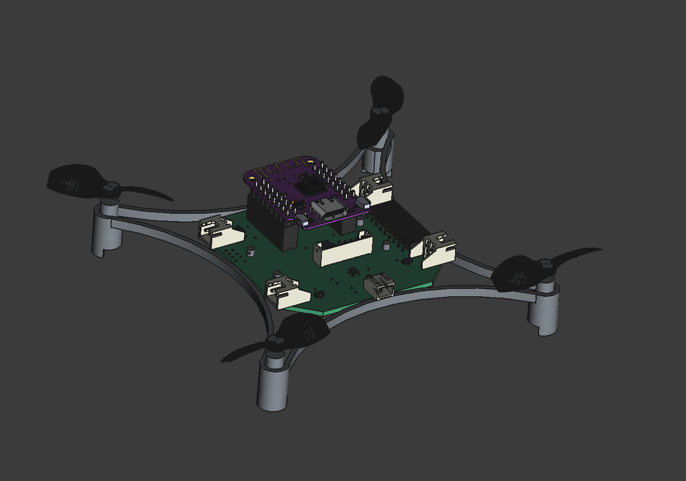

# ESP Micro Drone
## Intro
Development of a micro drone based on an ESP platform, adapted and extended through the integration of ROS 2. It uses an ESP32-S2 mini as flight controller and talks to a ROS 2 computer over WiFi with micro-ROS.  

  

 

## Repository

| Folder | What it is |
|--------|------------|
| [`code/`](https://github.com/ruibartsegura/ESP-Micro_drone/tree/main/code) | Firmware of the ESP32-S2 (ESP-IDF + micro-ROS), host unit tests and the ROS 2 workspace. |
| [`PCB_design/`](https://github.com/ruibartsegura/ESP-Micro_drone/tree/main/PCB_design) | KiCad project of the drone PCB, with the files to manufacture it. |
| `Hardware_Design/` | FreeCAD models of the frame, motors, blades and the complete drone. |
| `img/` | Images used in the READMEs. |

## [PCB Design](https://github.com/ruibartsegura/ESP-Micro_drone/tree/main/PCB_design)
The PCB is the frame of the drone. The ESP32-S2 mini and a GY-87 sensor board (MPU-6050 + BMP180) are plugged into it, and it has the drivers of the 4 motors, the 3.3 V regulator, the battery connector and the status LEDs.

## [Code](https://github.com/ruibartsegura/ESP-Micro_drone/tree/main/code)
The firmware runs every part of the drone as a FreeRTOS task: sensors, state machine, cascade PID controller, odometry and the micro-ROS node. The same firmware can also fly a simulated drone in Gazebo, so the controller can be tested before flying the real one. See [`code/README.md`](code/README.md) to build, flash and fly it.
